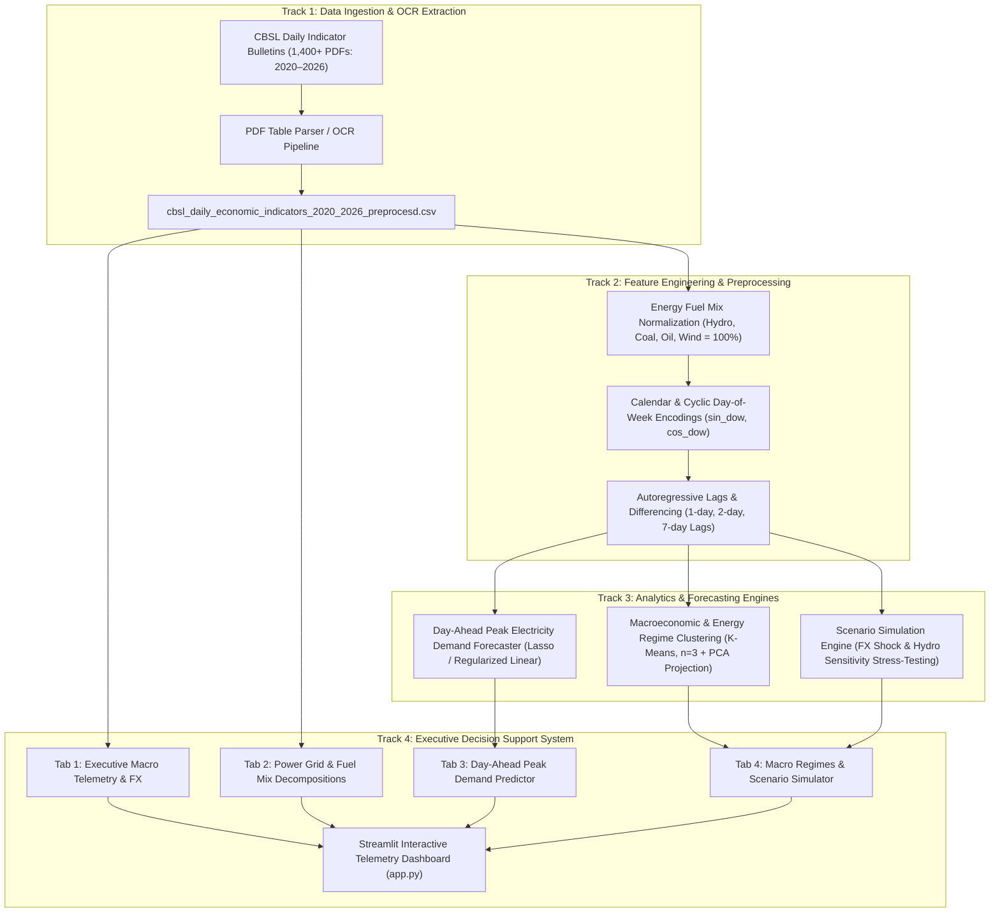

# System Architecture & Technical Specification

## Project Overview
**Title**: CBSL Macro-Financial and Energy Grid Forecasting: An Integrated Multi-Track Analytical & Predictive Framework  
**Course**: Capstone Project in Data Science II (Semester IV)  
**Institutions / Data Cohorts**: Central Bank of Sri Lanka (CBSL), Ceylon Electricity Board (CEB), Department of Census and Statistics (DCS).

---

## 1. Multi-Track Architectural Pipeline

---

## 2. Directory Layout & Module Responsibilities

- **`config/config.yaml`**: Centralized configuration specifying data sources, feature mappings, model hyper-parameters, and visualization styles.
- **`data/`**:
  - `data/raw/`: Reference to original daily PDF bulletins (`raw_pdfs/`).
  - `data/processed/`: Modeling-ready normalized daily time series (`cbsl_daily_economic_indicators_2020_2026_preprocesd.csv`).
- **`src/cbsl_forecast/`**:
  - `data/loader.py`: Automated ingestion, sorting, calendar generation, and synthetic fallback generation.
  - `features/build_features.py`: Computes autoregressive delta targets ($y_t = \text{Demand}_t - \text{Demand}_{t-1}$), multi-horizon lag differences, and cyclic day-of-week sine/cosine transformations.
  - `models/demand_model.py`: Day-ahead peak demand forecasting pipeline with standardization and L1 regularization.
  - `models/regimes.py`: Multi-indicator macroeconomic regime clustering (K-Means) with 2D principal component analysis (PCA).
  - `utils/visualization.py`: Unified Plotly styling, responsive layouts, color maps, and time navigation range sliders.
- **`app.py`**: Streamlit executive web application maintaining complete backward-compatibility and real-time interaction.
- **`tests/`**: Pytest test suite validating data integrity, preprocessing correctness, feature math, and model training convergence.
